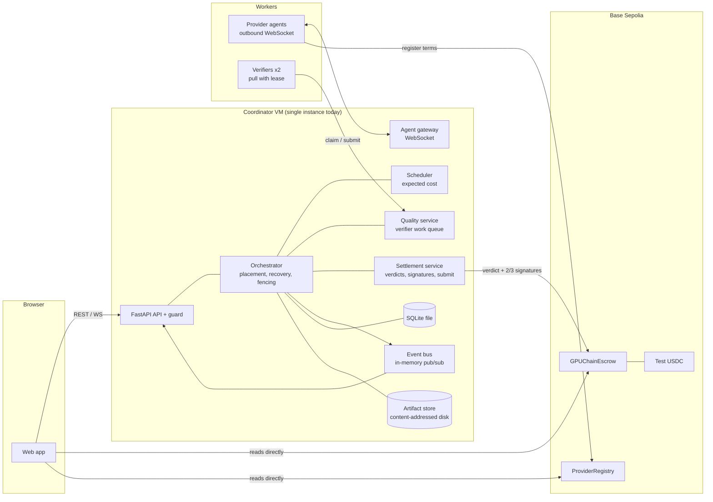

# Ekido system design

How the whole product is built, where every piece of state lives, what happens when each part fails, and how it scales. Written 9 Nov 2026 from the code as it stands. Measured numbers come from `experiments/results/`; anything else is marked as an estimate.

## 1. Requirements

**Functional:**
- A client locks a budget and submits a training job.
- The network places it on a GPU, checkpoints it, and moves it when the GPU dies.
- Verifiers test the result.
- The escrow pays each provider for accepted steps and refunds the rest.
- Anyone can rent out a GPU with one command, and anyone can audit the money on-chain.

**Non-functional, in priority order:**
1. **Money is never wrong.** Correctness beats availability. A payout that can't be proven isn't made.
2. **Work survives a provider dying.**
   - Measured detection: 0.6 s on the 4 Nov run, and 0.1 to 0.23 s on the 9 Nov GPU rounds.
   - Measured resume: 65 s, most of it re-checking the checkpoint.
3. **Funds survive the operator dying.** A refund is permissionless after the deadline.
4. **Everything financial is auditable without trusting us.**
5. **Availability of the scheduling service:** best effort today, 99.5% as the Phase B target.

**Scale:**
- **Today:** tens of providers, one to five concurrent jobs.
- **Phase B (estimate):** 1,000 providers and 100 concurrent jobs.

## 2. Architecture



**Design choices:**
- **Agents connect out, so providers behind NAT work.** Verifiers pull work with a lease, so a dead verifier's task returns to the pool.
- **The browser reads the chain itself.** Money pages never depend on the coordinator telling the truth.
- **The chain is the ledger; the database is the orchestration log.** On a disagreement about money, the chain wins.

## 3. Where state lives

The single most important table. It explains every scaling and failure limit below.

| State | Owner | Store | Survives a restart? | Notes |
|---|---|---|---|---|
| Budgets, payouts, refunds, withdrawable balances | Escrow contract | Base Sepolia | Yes, permanently | The source of truth for money |
| Provider terms (name, price, memory) | Provider's wallet | ProviderRegistry | Yes | The coordinator's copy is checked against it |
| Jobs, transitions, assignments, fencing tokens | Orchestrator | SQLite | Yes | Single writer |
| Checkpoint manifests, recovery events, adaptations | Orchestrator | SQLite | Yes | |
| Checkpoint tensors | Artifact store | Local disk, by SHA-256 | Yes, on that disk | Immutable; append-only backup since 9 Nov |
| Quality decisions, attestations | Quality / Settlement | SQLite (`QualityDecision`, `VerificationAttestation`, `SettlementProposal`) | Yes | |
| Verdicts waiting for signatures | Settlement | Memory + `SettlementProposal` | Rebuilt by `restore_pending` | Partial signatures are re-collected |
| In-flight evaluation tasks | Quality service | Memory | No | Work is re-queued when the job resumes |
| Live agent connections, probe futures | Agent gateway | Memory | No | Agents reconnect; the dead-man lease kills orphans |
| Event subscribers (browser streams) | Event bus | Memory | No | Browsers reconnect and refetch |
| Join rate limits | API | Memory | No | Fine for one instance; see Phase B |

**Consequence:** the coordinator is a **stateful singleton**. Its memory holds sessions and queues that only make sense on one machine. That's why a second replica can't simply be added today, and why Phase B is about moving that state out.

## 4. Key flows

**Job lifecycle.** Each state change is a compare-and-set on `(state, state_version)` and is logged in `job_transitions`:

```text
OPEN → ASSIGNED → RUNNING ⇄ RECOVERING → VALIDATING → COMPLETED → SETTLED
                                   ↘ FAILED → REFUNDED
```

**Recovery:**
1. Detect: process exit, or heartbeats missed.
2. Fence: bump the fencing token, so the old worker's writes get a 409.
3. Pick the newest accepted checkpoint.
4. Compile a plan for each candidate GPU and run a real memory probe.
5. Assign the job and restore it.
6. Re-run the canary loss.
7. Resume.

The logical-step invariant keeps the math identical on any GPU.

**Verification:**
1. Verifiers claim tasks with a lease.
2. Each evaluates in FP32 and signs a report.
3. A quorum of 2 of 3 must agree on the same checkpoint hash.
4. Probation checks run mid-run, and a final check runs at the end.

**Settlement:**
1. Propose: payouts are worked out from the accepted lineage, the agreed prices and the protocol fee, all taken from the funded spec.
2. Verifiers recompute everything themselves and sign the EIP-712 verdict.
3. The coordinator submits the attestation.
4. After the dispute window, anyone can finalize.
5. Each payee withdraws its own money.

This is safe to retry at every step:
- The chain state is read before each send.
- An expiring verdict is rebuilt rather than submitted.

**Provider join:**
- **Off-chain:** a wallet-signed document sent to `POST /providers/join`. It's rate-limited and the name must be unique.
- **On-chain:** `register(keccak(terms))` from the provider's own wallet.

## 5. Consistency model

- **Money is strongly consistent and final.** It's whatever the contract says. The contract enforces `payouts + fee + refund = budget` and the signer quorum.
- **Orchestration is serializable per job.** There's a single writer, compare-and-set transitions, and idempotency keys on every mutating call.
- **Chain writes are at-least-once with idempotent effects.** The service reads state before sending and treats "already done" as success.
- **The dashboard is eventually consistent.** Events are a convenience; the browser recomputes money from the chain.

## 6. Failure analysis

| Failure | Effect today | Recovery | Gap |
|---|---|---|---|
| Provider dies | Job pauses | Automatic: fence, restore, resume elsewhere | None at this scale |
| Provider cheats | Bad checkpoint | Refused by quorum, rolled back, unpaid | Bounded by the statistical margin |
| A verifier dies | Fewer signatures | The lease expires and the other verifier re-claims; 2 of 3 still possible | If 2 die, settlement waits |
| Coordinator process crashes | Scheduling stops; money safe | systemd restarts it in 15 s; proposals restored from DB; agents reconnect | In-flight evaluations re-queue |
| VM dies | Scheduling stops; money safe | Manual rebuild. A timeout refund is permissionless | **Single point of failure** |
| Disk lost | Job history and checkpoints lost; money safe on-chain | Daily backups, copied to a private S3 bucket the server can't delete from; the AWS move on 15 Nov restored from a backup | Single region |
| RPC outage | Settlement delayed | Retries; `/readyz` reports it | One RPC per service; add fallback |
| Coordinator out of gas | Settlement can't submit | `/readyz` flags it under 0.002 ETH, and the uptime check emails the team | Gas top-up is manual |
| Coordinator key stolen | Can start jobs and anchor events; **can't move funds** | Rotate via the owner | Owner is one key; multisig needed |
| 2 verifier keys stolen | Could sign a bad split | Dispute window plus arbiter | Verifiers are team-run |
| Chain reorg | A settlement tx re-orgs | Read-before-send retry | Low risk on an L2 |
| Join flood | 200-provider cap reached | Per-IP limits (proxy-aware), plus per-client token buckets on every route | Memory limits reset on restart |

## 7. Bottlenecks and how each scales

| Bottleneck | Why it binds | Phase B change |
|---|---|---|
| One coordinator holds sockets, queues and the event bus in memory | No second replica possible | Shard by job: each job is owned by one instance through a lease row in Postgres (`job_leases`, renewed every 10 s). Agents reconnect to any instance; a shared broker routes to the owner |
| SQLite: one writer, one file | Concurrency and durability | Managed Postgres with point-in-time recovery; the models already use SQLAlchemy |
| Artifacts on local disk | Disk loss; one machine serves all downloads | Retention and per-job quotas are done. Next: object storage (S3) behind the same SHA-256 interface, with presigned URLs so the coordinator doesn't relay bytes |
| In-memory event bus | Can't fan out across replicas | Redis pub/sub or NATS, keyed by job |
| Browser scans 900k+ blocks on each `/chain` load (about 20 RPC calls) | Public RPC limits as traffic grows | Done: a small indexer caches raw logs (5 confirmations) and serves them in one request; the browser checks the result against the contracts' own totals and rescans the chain if anything disagrees |
| Verifier capacity | Two team-run verifiers | Already pull-based with leases, so more verifiers just claim more tasks. Pay them from the fee (3% proposed) |
| Rate limits in memory (240 reads, 40 writes per minute per client) | Reset on restart; not shared | Postgres or Redis token buckets; edge limits in Caddy |

**Capacity, estimated for Phase B (100 concurrent jobs, 1,000 providers):**
- **Heartbeats:** about 500 messages/s at one every 2 s. A single async gateway handles that; sharding is for availability, not throughput.
- **Telemetry:** about 200 rows/s. That's batched writes to Postgres, or downsampling to 1 per 10 s for history.
- **Checkpoints:** a LoRA checkpoint is a few MB (estimate; measure before sizing). At one per 50 steps it's tens of GB per day, which is object-storage territory.

## 8. Security architecture

- **Trust boundaries:**
  - Providers are untrusted: work is signed, fenced and verified.
  - Verifiers are trusted only as a quorum.
  - The coordinator can't move funds.
  - The owner can only change future verifier sets.
- **Keys:** one per role, in root-only environment files, never in code or logs. Phase B: a KMS, separate accounts per role, and a multisig owner.
- **Edge:**
  - HTTPS everywhere, with HSTS and a strict CSP whose `connect-src` is an allowlist.
  - No framing, `nosniff`, and the Server header hidden.
  - The operator API needs a token or loopback.
- **Provider machines:**
  - Allowlisted workloads only.
  - Docker sandbox available: no network, read-only, capped memory.
  - Checkpoints are safetensors only, validated before loading.

## 9. Operations (live since 9 and 10 Nov, on AWS since 15 Nov)

- **Server:** one EC2 instance in Mumbai (`ap-south-1`) with no SSH port. It is managed only through SSM, its secrets live in SSM Parameter Store, and `infra/server/bootstrap.sh` plus `restore.sh` rebuild it from scratch.

- **Health:**
  - `/healthz` for liveness.
  - `/readyz` for readiness: DB, a disk write plus free space, RPC block age, coordinator gas, and settlement backlog. It returns 503 if any check fails.
- **Monitor:** a systemd timer every 5 minutes checks `/readyz`, every service, the public URLs and disk use. Problems go to `journalctl -t ekido-monitor -p err` and `/var/lib/ekido-monitor/last.json`.
- **Backups:** daily at 03:00 UTC, a consistent SQLite snapshot (integrity-checked, gzipped) plus an append-only artifact copy, under `/var/backups/ekido`, then copied to a private, encrypted S3 bucket. The server's role can add objects but not delete them; snapshots expire after 90 days.
- **Retention:** a daily timer applies the checkpoint keep rules (recent and last two accepted checkpoints while a job runs, only the final model for 90 days after it ends) and moves anything else to a quarantine kept for 30 days. Per-job and per-upload storage caps stop one job from filling the disk.
- **Alerts:** a GitHub Actions workflow checks `/readyz` and the site pages every 15 minutes, and a failure emails the admins. An AWS budget emails the team at 50, 80 and 100% of the monthly limit.
- **Restart:** every service, including the network's own CPU provider, is a systemd unit enabled at boot. A full VM restart on 10 Nov came back ready in about 2 minutes.
- **Deploys:** guarded scripts that refuse to restart with a job in flight, keep the previous build outside the app, and roll back if a build fails.

## 10. Roadmap

| Phase | Change | Why |
|---|---|---|
| A, done | Readiness, monitor, backups, hardened join, security headers | Know when it breaks; don't lose history |
| A, done (10 Nov) | Off-site backup copy; email alerts from uptime checks | Disk-loss safety; a human hears about it |
| A, done (15 Nov) | Move to AWS with no SSH; checkpoint retention, quarantine and storage caps; budget alerts | Simpler, safer operations; storage that stays bounded |
| B | Postgres, object storage, job leases, shared event bus, a second coordinator | Remove the single point of failure |
| B, partly done | Indexer with browser checks (done); per-client rate limits (done); edge limits in Caddy | Read path scales without trusting us |
| C | Multisig owner, independent paid verifiers, slashing | Decentralize the parts we run today |
| C | Audit, then mainnet | Real money |
